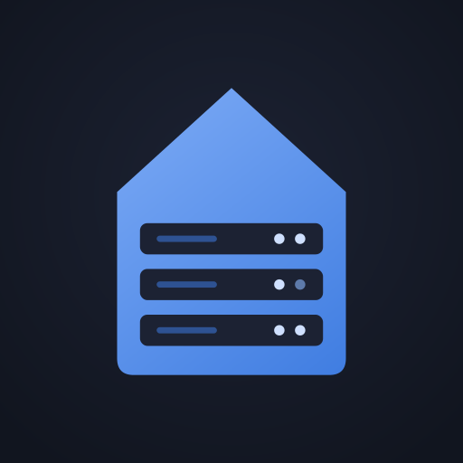

<p align="center">
  
</p>

<h1 align="center">glance-config</h1>

<p align="center">
  Configuration de mon tableau de bord <a href="https://github.com/glanceapp/glance">Glance</a> pour un homelab Proxmox.
</p>

---

## Aperçu

Le dashboard comporte deux pages.

**Home** : la page de tous les jours.
- Calendrier, météo et barre de recherche
- Flux RSS, Hacker News, Lobsters et Reddit (self-hosted, homelab)
- Vidéos YouTube autour de l'auto-hébergement
- Suivi de marchés (actions, ETF, crypto)

**Homelab** : la supervision.
- **Proxmox** : CPU, RAM et stockage du nœud, état de chaque conteneur LXC et VM, uptime (via l'API Proxmox)
- **Services** : état et temps de réponse de chaque application, regroupés par catégorie
- **Uptime Kuma** : sondes impossibles à tester en HTTP (serveur de jeu en TCP, ping…)
- Favoris, horloges et suivi des nouvelles versions des outils utilisés

Le thème reprend la palette [Catppuccin Mocha](https://github.com/catppuccin/catppuccin).

## Structure

```
glance-config/
├── glance.yml            # Point d'entrée : thème, branding, liste des pages
├── tabs/
│   ├── home.yml          # Page « Home »
│   └── homelab.yml       # Page « Homelab »
├── widgets/
│   ├── proxmox.yml       # Ressources Proxmox (custom-api)
│   ├── monitors.yml      # État des services
│   ├── uptime-kuma.yml   # Sondes Uptime Kuma (custom-api)
│   ├── bookmarks.yml     # Favoris
│   ├── releases.yml      # Nouvelles versions GitHub
│   ├── markets.yml       # Marchés
│   ├── rss.yml           # Flux RSS
│   └── videos.yml        # Chaînes YouTube
├── assets/
│   └── logo.png          # Logo et favicon
└── .env.example          # Modèle des variables d'environnement
```

Chaque page et chaque widget est dans son propre fichier, assemblé avec la directive `$include` de Glance. Pour ajouter ou retirer un bloc, il suffit de modifier une ligne dans `tabs/`.

## Aucune donnée sensible dans le dépôt

Ce dépôt est public. **Il ne contient ni adresse IP, ni port, ni nom de domaine, ni secret.** Ces valeurs sont remplacées par des variables `${...}`, que Glance remplit au démarrage à partir de son environnement.

| Variable | Rôle | Exemple |
|---|---|---|
| `DOMAIN` | Domaine des services (liens cliquables) | `exemple.duckdns.org` |
| `PROXMOX_TOKEN` | Token API Proxmox en lecture seule | `utilisateur@pve!nom_token=secret` |
| `PVE_URL` | API Proxmox | `https://ip-proxmox:8006` |
| `PORTAINER_URL` | Portainer | `https://ip-docker:9443` |
| `NPM_URL` | Nginx Proxy Manager | `http://ip-docker:81` |
| `GATEWAY_URL` | Box / routeur | `http://ip-box` |
| `GRAFANA_URL` | Grafana | `http://ip-docker:3000` |
| `PROMETHEUS_URL` | Prometheus | `http://ip-docker:9090` |
| `KUMA_URL` | Uptime Kuma | `http://ip-docker:3001` |
| `DOCMOST_URL` | Docmost (optionnel) | `http://ip-docker:3002` |

Glance refuse de démarrer si une variable utilisée est absente, et indique laquelle dans ses logs.

> ⚠️ Ne jamais committer de fichier `.env` contenant de vraies valeurs. Le `.gitignore` les exclut par défaut.

## Installation

### Prérequis

- Docker, avec [Portainer](https://www.portainer.io/) (ou Docker Compose)
- Glance v0.7 ou plus récent (pour `$include`)

### 1. Récupérer la configuration

Sur la machine qui héberge Glance :

```bash
git clone https://github.com/RolinaS/glance-config.git /opt/glance-config
mkdir -p /opt/appdata/glance/config /opt/appdata/glance/assets
cp -r /opt/glance-config/glance.yml /opt/glance-config/tabs /opt/glance-config/widgets /opt/appdata/glance/config/
cp /opt/glance-config/assets/logo.png /opt/appdata/glance/assets/
```

### 2. Créer la stack

Dans Portainer : **Stacks → Add stack**.

```yaml
services:
  glance:
    image: glanceapp/glance:latest
    container_name: glance
    restart: unless-stopped
    ports:
      - "8080:8080"
    env_file:
      - stack.env
    volumes:
      - /opt/appdata/glance/config:/app/config
      - /opt/appdata/glance/assets:/app/assets
```

Dans **Environment variables → Advanced mode**, coller les variables du tableau ci-dessus avec leurs vraies valeurs. Portainer génère lui-même le fichier `stack.env` à partir de cette liste.

Avec Docker Compose sans Portainer, il suffit de créer un fichier `stack.env` à côté du `docker-compose.yml`, sur le modèle de `.env.example`.

### 3. Token Proxmox (lecture seule)

Le widget Proxmox n'a besoin que d'un accès en lecture. Sur l'hôte Proxmox :

```bash
pveum user add monitoring@pve
pveum aclmod / -user monitoring@pve -role PVEAuditor
pveum user token add monitoring@pve glance --privsep 0
```

La valeur de `PROXMOX_TOKEN` prend alors la forme `monitoring@pve!glance=<secret affiché>`.

Pour vérifier le token :

```bash
curl -sk -o /dev/null -w "%{http_code}\n" \
  -H 'Authorization: PVEAPIToken=monitoring@pve!glance=SECRET' \
  https://ip-proxmox:8006/api2/json/cluster/resources
```

Le code attendu est `200`.

### 4. Page de statut Uptime Kuma

Le widget lit une page de statut publique dont le slug est **`homelab`**. Dans Uptime Kuma :

1. Créer les sondes souhaitées (TCP, ping, HTTP…).
2. **Pages de statut → Nouvelle page**, avec le slug `homelab`.
3. Ajouter les sondes à la page, puis enregistrer.

Pour vérifier : `curl http://ip-docker:3001/api/status-page/homelab` doit renvoyer du JSON.

## Mise à jour

Après une modification poussée sur GitHub :

```bash
cd /opt/glance-config && git pull \
  && cp -r glance.yml tabs widgets /opt/appdata/glance/config/ \
  && docker restart glance
```

## Ajouter un service

1. Créer une variable dans Portainer, par exemple `NEXTCLOUD_URL=http://ip:port`, puis **Update the stack**.
2. Ajouter le service dans `widgets/monitors.yml`, dans la catégorie voulue :

```yaml
    - title: Nextcloud
      url: https://cloud.${DOMAIN}
      check-url: ${NEXTCLOUD_URL}
      icon: di:nextcloud
```

- `url` : lien ouvert au clic
- `check-url` : adresse testée par Glance (de préférence l'adresse locale)
- `icon` : `di:<nom>` pour une icône de [Dashboard Icons](https://dashboardicons.com), ou une URL d'image

3. Committer, puis appliquer la procédure de mise à jour.

## Dépannage

| Symptôme | Piste |
|---|---|
| Glance ne démarre pas | `docker logs glance` : variable manquante ou erreur d'indentation YAML (espaces uniquement, jamais de tabulation) |
| « API Proxmox injoignable ou token invalide » | Vérifier `PROXMOX_TOKEN` (pas de guillemets, pas d'espace, pas de `PVEAPIToken=` devant) avec le test `curl` ci-dessus |
| « Page de statut introuvable » | La page Uptime Kuma `homelab` n'existe pas ou ne contient aucune sonde |
| Une icône ne s'affiche pas | Remplacer `di:<nom>` par l'URL brute de l'icône sur GitHub |

## Crédits

- [Glance](https://github.com/glanceapp/glance) par glanceapp
- Organisation et widgets Proxmox / Uptime Kuma inspirés de [AyLabsCode/glance-templates](https://github.com/AyLabsCode/glance-templates)
- Icônes : [Dashboard Icons](https://github.com/homarr-labs/dashboard-icons)
- Palette : [Catppuccin](https://github.com/catppuccin/catppuccin)
